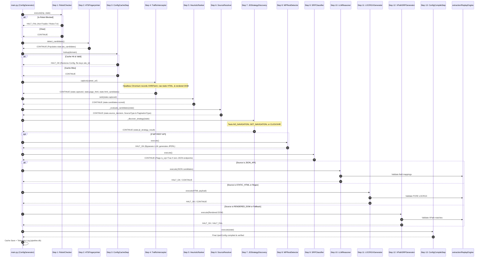

# AI-Powered JPERL & XPath Configuration Engine

> **This document is the definitive master architecture guide and single source of truth for the AI-Config-Engine.**
> It covers every flow, class, method, design principle, data contract, extraction engine, and backend handoff in exhaustive detail.
> **Last updated: 2026-09-08 (v7 — 13-Step Unified Architecture with Multi-Engine Replay, Automated JD Strategy Discovery, URL Template Normalization, and Multi-Provider LLM Gateway)**

---

## Table of Contents

1. [System Overview & Domain Context](#1-system-overview--domain-context)
   - [The Problem & TechOps Workflow](#the-problem--techops-workflow)
   - [What This Tool Does (and Does NOT Do)](#what-this-tool-does-and-does-not-do)
   - [OMS Business Taxonomy & Mapping](#oms-business-taxonomy--mapping)
2. [High-Level Architecture & Execution Flow](#2-high-level-architecture--execution-flow)
   - [Pipeline Design Principles](#pipeline-design-principles)
   - [End-to-End Visual Sequence Diagram](#end-to-end-visual-sequence-diagram)
   - [State Management (`PipelineState` & `StepSignal`)](#state-management-pipelinestate--stepsignal)
3. [The 13 Pipeline Steps: Exhaustive Deep Dive](#3-the-13-pipeline-steps-exhaustive-deep-dive)
   - [Step 1: RobotChecker](#step-1-robotchecker-srcrobot_checkerpy)
   - [Step 2: ATSFingerprinter](#step-2-atsfingerprinter-srcats_fingerprinterpy)
   - [Step 3: ConfigCacheStep](#step-3-configcachestep-srcconfig_cachepy)
   - [Step 4: TrafficInterceptor](#step-4-trafficinterceptor-srctraffic_interceptorpy)
   - [Step 5: HeuristicRanker](#step-5-heuristicranker-srcheuristic_rankerpy)
   - [Step 6: SourceResolver](#step-6-sourceresolver-srcsource_resolverpy)
   - [Step 7: JDStrategyDiscovery](#step-7-jdstrategydiscovery-srcjd_strategy_discoverypy)
   - [Step 8: WPRestDetector](#step-8-wprestdetector-srcwp_rest_detectorpy)
   - [Step 9: SRPClassifier](#step-9-srpclassifier-srcsrp_classifierpy)
   - [Step 10: LLMReasoner](#step-10-llmreasoner-srcllm_reasonerpy)
   - [Step 11: LOCRGXGenerator](#step-11-locrgxgenerator-srclocrgx_generatorpy)
   - [Step 12: XPathSRPGenerator](#step-12-xpathsrpgenerator-srcxpath_srp_generatorpy)
   - [Step 13: ConfigCompileStep](#step-13-configcompilestep-srccompile_steppy)
4. [Compiler Subsystem & Config Generation Specs](#4-compiler-subsystem--config-generation-specs)
   - [Complete JPERL Key-Value DSL Specification](#complete-jperl-key-value-dsl-specification)
   - [Path A: ATS Parent Rules](#path-a-ats-parent-rules)
   - [Path B: JPERL JSON APIs (`LOCJSON`, `LOCJSONSEQ`)](#path-b-jperl-json-apis-locjson-locjsonseq)
   - [Path C: JPERL HTML Regex (`LOCRGX`, `LOCRGXSEQ`)](#path-c-jperl-html-regex-locrgx-locrgxseq)
   - [Path D: XPath SRPAUTOMATION](#path-d-xpath-srpautomation)
   - [Two-Phase Deep Crawling (`MOVE_TO_JD = 1`, `JDRGX`, `JDJSON`)](#two-phase-deep-crawling-move_to_jd--1-jdrgx-jdjson)
   - [URL Template Normalization (`{{VARJOBLINK}}`)](#url-template-normalization-varjoblink)
   - [Dynamic CSRF / Nonce Token Alignment](#dynamic-csrf--nonce-token-alignment)
5. [Replay & Semantic Validation Engine](#5-replay--semantic-validation-engine)
   - [`ReplayEngine` Orchestration](#replayengine-orchestration)
   - [`JsonParser` & Pipe-Delimited Path Evaluator](#jsonparser--pipe-delimited-path-evaluator)
   - [`RegexParser` & PCRE Group Mapping](#regexparser--pcre-group-mapping)
   - [`XPathParser` & HTML DOM Traversal](#xpathparser--html-dom-traversal)
   - [`CandidateReplayer` Deterministic Inspector](#candidatereplayer-deterministic-inspector)
   - [Semantic Validation & Negative Token Heuristics (`src/validation.py`)](#semantic-validation--negative-token-heuristics-srcvalidationpy)
   - [Automated Failure Categorization (`classify_failure`)](#automated-failure-categorization-classify_failure)
6. [Detail Extraction Subsystem (`src/jd_extractor.py`)](#6-detail-extraction-subsystem-srcjd_extractorpy)
   - [Multi-Sample Cross-Validation](#multi-sample-cross-validation)
   - [Adaptive HTML Windowing](#adaptive-html-windowing)
   - [Protected `JOBDESC` & Secondary Metadata Extraction](#protected-jobdesc--secondary-metadata-extraction)
7. [Resilient Infrastructure & API Gateways](#7-resilient-infrastructure--api-gateways)
   - [Multi-Provider LLM Gateway (`src/llm_client.py`)](#multi-provider-llm-gateway-srcllm_clientpy)
   - [Browser Session Management (`src/browser_manager.py`)](#browser-session-management-srcbrowser_managerpy)
   - [SQLite Caching Architecture (`config_cache.db`)](#sqlite-caching-architecture-config_cachedb)
   - [Telemetry & Audit Logging (`pipeline.db`)](#telemetry--audit-logging-pipelinedb)
8. [Directory & File Organization](#8-directory--file-organization)
9. [AI Agent Cheatsheet: Traps, Invariants & Troubleshooting](#9-ai-agent-cheatsheet-traps-invariants--troubleshooting)
10. [Developer & TechOps Guide](#10-developer--techops-guide)
    - [Environment Setup & Installation](#environment-setup--installation)
    - [Running Targeted Batches & CLI](#running-targeted-batches--cli)
    - [Test Suite & Quality Verification](#test-suite--quality-verification)

---

## 1. System Overview & Domain Context

### The Problem & TechOps Workflow
In recruitment data engineering at Naukri, scraping jobs from thousands of disparate corporate career portals requires maintaining high-precision crawler configurations. Traditionally, a TechOps engineer performs a manual 6-step analysis:
1. **Navigate to Career Site:** Open the target URL in Google Chrome.
2. **Inspect Network Traffic:** Open DevTools (F12) $\rightarrow$ Network Tab $\rightarrow$ filter XHR/Fetch requests.
3. **Trace Job Payloads:** Search for known job titles visible on the screen across network responses.
4. **Identify Integration Link:** Extract endpoint URL, HTTP method, query parameters, headers, and request bodies.
5. **Determine Config Path:**
   - If response is structured JSON $\rightarrow$ Map keys to JPERL `LOCJSON` / `LOCJSONSEQ`.
   - If response is static/dynamic HTML $\rightarrow$ Synthesize PCRE regex `LOCRGX` / `LOCRGXSEQ`.
   - If site renders via JavaScript DOM without an API $\rightarrow$ Generate XPath for `SRPAUTOMATION`.
6. **Deep Crawling Decision (`MOVE_TO_JD`):** Determine if full job descriptions exist in the listing or require clicking into individual detail pages (`MOVE_TO_JD=1` $\rightarrow$ generate `JDRGX1..N` or `JDJSON1..N`).

This manual process requires 15–30 minutes per company. **AI-Config-Engine automates this entire pipeline end-to-end in seconds**, with zero-regression architectural validation and deterministic replay verification.

```
┌────────────────────────────────────────────────────────────────────────────────────────┐
│                                   HIGH LEVEL ECOSYSTEM                                 │
├────────────────────┬─────────────────────────────────┬─────────────────────────────────┤
│ [Mapping / Input]  │       [AI-Config-Engine]        │       [Downstream Systems]      │
│                    │                                 │                                 │
│  crawlerId         │  1. Pre-flight & Robots Check   │  • TechOps Review & Deployment  │
│  companyName   ───►│  2. ATS Signature Fingerprint   │  • JPERL Production Crawler     │
│  siteId            │  3. Playwright Traffic Capture  │  • SRPAUTOMATION Browser Worker │
│  careerSiteUrl     │  4. Deterministic Replay / LLM  │  • OMS Tracking (Activity.xlsx) │
│  expectedJobs      │  5. Compilation & Validation    │                                 │
│                    │  6. Final JSON Config Output ───┼────────────────────────────────►│
└────────────────────┴─────────────────────────────────┴─────────────────────────────────┘
```

### What This Tool Does (and Does NOT Do)
* **What It DOES:**
  - Automatically identifies whether a site uses an ATS, JSON API, Static HTML, or Rendered DOM.
  - Generates ready-to-deploy JPERL (JSON/Regex) and SRPAUTOMATION (XPath) configuration blocks.
  - Replays and validates synthesized configs against live site payloads to verify job title, ID, link, location, experience, and description accuracy.
  - Resolves complex pagination (Page numbers, Offset, Cursors, Infinite Scroll, Load More).
  - Automatically verifies detail page links and generates secondary regex/JSON parsers (`JDRGX`/`JDJSON`).
* **What It DOES NOT Do:**
  - It does **not** store or index job listings for production search (that is the job of the production crawler runtime).
  - It does **not** bypass legal hard walls (e.g. CAPTCHAs or explicit `robots.txt` disallow blocks — these are classified as `Non-Workable` or `Not Fixable`).

### OMS Business Taxonomy & Mapping

Every execution terminates in a deterministic state that maps directly to Naukri's Operational Management System (OMS):

| OMS Field | Output Values | Meaning / Context |
|---|---|---|
| `techStatus` | `Done`<br>`Failed`<br>`Non-Workable`<br>`Not Fixable`<br>`In Process` | • `Done`: Production-ready config generated and verified via replay.<br>• `Failed`: Crawler could not be auto-generated; TechOps manual intervention required.<br>• `Non-Workable`: Site is down, network connection refused, or 0 active jobs.<br>• `Not Fixable`: Explicitly blocked by `robots.txt`.<br>• `In Process`: Transient pipeline state. |
| `subTechComment` | `Jobs in New Pool`<br>`Already Live`<br>`Robot. Txt`<br>`No Job`<br>`CareerSite Down`<br>`Jobs Shared Manually` | Detailed operational reason for the assigned `techStatus`. All newly generated configs output `Jobs in New Pool`. |
| `siteType` | `ATS`<br>`SRP`<br>`Manual` | • `ATS`: Platform-backed or API-driven feed (Greenhouse, Workday, Zoho, REST API).<br>• `SRP`: Custom HTML Search Results Page.<br>• `Manual`: Static offline page requiring manual posting. |
| `crawlerType` | `JPERL`<br>`SRPAUTOMATION`<br>`OFFLINEPOSTED` | • `JPERL`: High-performance Perl-based regex/JSON crawler.<br>• `SRPAUTOMATION`: Headless browser-driven XPath crawler.<br>• `OFFLINEPOSTED`: Offline manual entry. |
| `primary_config_type` | `jperl` \| `xpath` | Declares which configuration payload is the primary deployment target. |

---

## 2. High-Level Architecture & Execution Flow

### Pipeline Design Principles

1. **Open/Closed Principle (OCP):** The pipeline is an ordered list of `PipelineStep` instances. New steps can be added or reordered without modifying the core `ConfigGenerator` execution loop.
2. **Cheapest-First Hierarchy:** Fast, deterministic, zero-I/O or cheap static checks execute before invoking heavy browser sessions or LLM APIs:
   $$\text{Robots / ATS URL Match (0ms)} \rightarrow \text{Cache (1ms)} \rightarrow \text{Playwright Interception (2-5s)} \rightarrow \text{Static LOCRGX (200ms)} \rightarrow \text{LLM Reasoning (1-3s)}$$
3. **Closed-Loop Replay Validation:** No configuration is accepted on faith. Every regex, JSON path, or XPath is immediately compiled and executed via `ReplayEngine` against the live page payload. If extraction yields 0 jobs or violates semantic schemas, it triggers self-healing or fails closed.
4. **Architectural Decoupling of Detail Crawling (`MOVE_TO_JD`):** Intermediate listing extraction does not prematurely validate detail page consistency before `JDExtractor` executes. Once both phases complete, final compilation strictly enforces cross-phase URL template integrity (`enforce_jd_consistency=True`).

### End-to-End Visual Sequence Diagram



### State Management (`PipelineState` & `StepSignal`)

Data is passed between pipeline steps via a single mutable container: `PipelineState` (defined in [`src/pipeline_step.py`](file:///c:/Users/nipun.kumar/Projects/config/src/pipeline_step.py)).

```python
class StepSignal(Enum):
    CONTINUE  = auto()   # Step completed normally; proceed to next step
    HALT_OK   = auto()   # Config successfully produced; stop pipeline early
    HALT_FAIL = auto()   # Irrecoverable error; abort pipeline with error status
```

#### Core Fields in `PipelineState`:
* `output: GeneratorOutput` $\rightarrow$ The final payload object holding status, config JSONs, confidence, and telemetry.
* `ats_candidates: list[ATSCandidate]` $\rightarrow$ ATS platforms identified by URL or HTML signature matches.
* `captured: list[CapturedRequest]` $\rightarrow$ All network requests (headers, bodies, status codes) intercepted by Playwright.
* `candidates: list[RankedCandidate]` $\rightarrow$ Filtered JSON API candidates scored by `HeuristicRanker`.
* `source_decision: Optional[SourceDecision]` $\rightarrow$ The architectural source classification (`JSON_API`, `STATIC_HTML`, `RENDERED_DOM`, `ATS`).
* `jd_strategy_result: Optional[JDStrategyResult]` $\rightarrow$ Detail page navigation type (`NO_NAVIGATION`, `GET_NAVIGATION`, `CLICK_NAVIGATION`, `XHR_NAVIGATION`) and job link evidence.
* `page_html: Optional[str]` $\rightarrow$ The live rendered DOM string after JavaScript execution.
* `raw_static_html: Optional[str]` $\rightarrow$ The raw initial HTTP GET response body.
* `html_candidates: list[HTMLCandidate]` $\rightarrow$ HTML-returning AJAX responses captured during user interaction.
* `locrgx_result: Optional[LOCRGXResult]` $\rightarrow$ Synthesized regex patterns and field sequences.
* `xpath_srp_result: Optional[XPathSRPResult]` $\rightarrow$ Synthesized XPath container and navigation selectors.

---

## 3. The 13 Pipeline Steps: Exhaustive Deep Dive

### Step 1: RobotChecker (`src/robot_checker.py`)
* **Purpose:** Queries the internal Naukri robot-protection service to verify whether the career URL or integration link is blocked by `robots.txt` or crawler exclusion policies.
* **Class:** `RobotChecker(PipelineStep)`
* **Internal Logic:**
  1. Inspects URL against known `robots_blocked` platforms defined in `knowledge_base/ats_platforms.json`.
  2. Queries `ROBOT_CHECKER_URL` using a pooled `requests.Session`.
  3. If status returns `2` (blocked):
     - Sets `state.output.tech_status = TechStatus.NOT_FIXABLE`.
     - Sets `state.output.sub_tech_comment = SubTechComment.ROBOT_TXT`.
     - Returns `StepSignal.HALT_FAIL`.
  4. Otherwise returns `StepSignal.CONTINUE`.

### Step 2: ATSFingerprinter (`src/ats_fingerprinter.py`)
* **Purpose:** High-speed deterministic detection of 21 standardized ATS platforms (e.g., Greenhouse, Lever, Workday, SmartRecruiters, Ashby, Taleo, SuccessFactors, Recruitee, Workable).
* **Class:** `ATSFingerprinter(PipelineStep)`
* **Internal Logic:**
  1. **URL Signatures:** Scans `career_site_url` and `integration_link` against signature substrings in `knowledge_base/ats_platforms.json`.
  2. **HTML Signatures:** Performs a lightweight static `GET` request to scan raw HTML for embedded platform markers (e.g. `grnh.se`, `lever-jobs-embed`, `ashby_app`).
  3. **Slug & Parameter Extraction:** Extracts tenant identifiers (`url_vars`) and API base paths (`url_start`) using regex extractors defined in the KB.
  4. **Rule Validation:** Validates that `parent_rule_name` exists in `knowledge_base/parent_rules.json`.
  5. Populates `state.ats_candidates` and returns `StepSignal.CONTINUE`.

### Step 3: ConfigCacheStep (`src/config_cache.py`)
* **Purpose:** SQLite-backed configuration cache that restores previous extraction results instantly for matching domains.
* **Class:** `ConfigCacheStep(PipelineStep)`
* **Database:** `knowledge_base/config_cache.db`
* **Internal Logic:**
  1. Computes normalized root domain (`_get_domain(url)`).
  2. Checks for cached entries where `expires_at > now()`.
     - **TTL:** 30 days for ATS/Parent-rule sites; 7 days for Custom JPERL / XPath sites.
  3. **Self-Healing Re-Keying:** When restoring a cached configuration, dynamically re-keys the top-level JSON dictionary and updates the SQL `POSTQUERY` using the current run's `site_id`, `company_name`, and `crawler_id`.
  4. If valid, sets `state.detection_path = "cache"` and returns `StepSignal.HALT_OK`.

### Step 4: TrafficInterceptor (`src/traffic_interceptor.py`)
* **Purpose:** Intercepts live browser network traffic, captures background AJAX/Fetch requests, extracts raw HTML, and serializes the rendered DOM.
* **Class:** `TrafficInterceptor(PipelineStep)`
* **Internal Logic:**
  1. **Pre-flight Dead-Site Check (`_is_dead_site`):** Sends a lightweight HTTP HEAD/GET request. If DNS fails or connection is refused, immediately marks `Non-Workable / CareerSite Down` without spinning up Playwright.
  2. **Browser Execution:** Obtains a headless Chromium instance via `BrowserSessionManager`.
  3. **Traffic Recording:**
     - Subscribes to `page.on("response")`.
     - Discards noisy MIME types (`image`, `stylesheet`, `font`, `media`, analytics).
     - Buffers all JSON and HTML XHR response bodies.
  4. **DOM Extraction:** Waits for `networkidle` (up to `PLAYWRIGHT_WAIT_MS`), scrolls dynamically to trigger lazy loading, and captures `page.content()`.
  5. Populates `state.captured`, `state.page_html`, and `state.html_candidates`.

### Step 5: HeuristicRanker (`src/heuristic_ranker.py`)
* **Purpose:** Zero-I/O scoring engine that filters hundreds of captured network requests down to the top $\le 3$ most probable job-feed API candidates.
* **Class:** `HeuristicRanker(PipelineStep)`
* **Scoring Rules:**
  * Base score: $+1.0$ if response body is valid JSON.
  * URL keywords (`job`, `career`, `opening`, `positions`, `requisition`): $+2.0$ each.
  * Response field keywords (`title`, `location`, `jobid`, `description`, `posting`): $+1.5$ each.
  * JSON array bonus: $+3.0$ if root or child property is a list of objects ($N \ge 2$).
  * Penalty: $-5.0$ if URL contains analytics or static file extensions.
* Populates `state.candidates: list[RankedCandidate]` sorted by score descending.

### Step 6: SourceResolver (`src/source_resolver.py`)
* **Purpose:** Core architectural classifier that resolves the primary `SourceType` and `PaginationType` using deterministic replay before any LLM is called.
* **Class:** `SourceResolver(PipelineStep)`
* **Candidate Evaluation Matrix:**
  1. Evaluates all candidates via `CandidateReplayer.replay()`.
  2. Categorizes candidates into 4 Completeness Tiers:
     - **Tier 1 (Complete):** Direct domain match + $\ge 3$ jobs + Title + Link + Inline Description.
     - **Tier 2 (Listing Only):** Direct domain match + $\ge 3$ jobs + Title + Link (requires `MOVE_TO_JD`).
     - **Tier 3 (Subdomain/Widget):** Cross-domain feed or widget with limited fields.
     - **Tier 4 (Incomplete):** Missing essential job fields or failed replay.
  3. Computes closeness score: $1.0 - \frac{|\text{items} - \text{expected}|}{\max(\text{items}, \text{expected})}$.
  4. Resolves `state.source_decision` to `JSON_API`, `STATIC_HTML`, `RENDERED_DOM`, or `ATS`.

### Step 7: JDStrategyDiscovery (`src/jd_strategy_discovery.py`)
* **Purpose:** Discovers how job descriptions must be extracted, eliminating guessing for downstream generators.
* **Class:** `JDStrategyDiscovery(PipelineStep)`
* **Discovery Workflow:**
  1. **Inline Check (`NO_NAVIGATION`):** Tests if sample jobs already contain full descriptions ($>100$ characters with keywords like `responsibilit`, `qualificat`, `requirement`). If true $\rightarrow$ sets `strategy = NO_NAVIGATION` (`MOVE_TO_JD = 0`).
  2. **Static Link Verification (`GET_NAVIGATION`):** Resolves job links against `career_site_url` and performs static HTTP `GET` requests. If detail pages return valid HTML containing job descriptions $\rightarrow$ sets `strategy = GET_NAVIGATION` (`MOVE_TO_JD = 1`).
  3. **Interactive Navigation (`CLICK_NAVIGATION` / `XHR_NAVIGATION`):** Uses Playwright to simulate clicks on job cards. Checks if modals open, URLs change, or background detail XHRs fire.
  4. Populates `state.jd_strategy_result`.

### Step 8: WPRestDetector (`src/wp_rest_detector.py`)
* **Purpose:** Dedicated zero-LLM fast path for WordPress REST API career portals (`/wp-json/wp/v2/jobs`).
* **Class:** `WPRestDetector(PipelineStep)`
* **Internal Logic:**
  1. Detects `wp-json/` in candidate URLs.
  2. Verifies JSON structure contains standard WP post fields (`title.rendered`, `id`, `link`, `content.rendered`).
  3. Automatically injects JPERL pagination query: `page=!1o!CURRENTPAGE!1o!`.
  4. Builds `LLMExtractionResult`, compiles JPERL config instantly with confidence $1.0$, and returns `StepSignal.HALT_OK`.

### Step 9: SRPClassifier (`src/srp_classifier.py`)
* **Purpose:** Identifies sites that have zero JSON API endpoints and render purely as HTML Search Results Pages (SRP).
* **Class:** `SRPClassifier(PipelineStep)`
* **Internal Logic:**
  1. If `state.candidates` contains valid JSON $\rightarrow$ returns `StepSignal.CONTINUE` (proceeds to JSON LLM).
  2. If all captured requests return non-JSON $\rightarrow$ flags `state.is_srp = True`, sets `SiteType.SRP`, `CrawlerType.SRPAUTOMATION`, and forwards execution to `LOCRGXGenerator` and `XPathSRPGenerator`.

### Step 10: LLMReasoner (`src/llm_reasoner.py`)
* **Purpose:** Multi-stage LLM reasoning engine for JSON API feeds.
* **Class:** `LLMReasoner(PipelineStep)`
* **Two-Stage Execution:**
  1. **Stage 1 (API Selection & Array Identification):** Prompts LLM with candidate URLs, headers, and truncated JSON payloads. The LLM performs Pros/Cons analysis and outputs the chosen `api_url`, `method`, `collection_path`, and `pagination_type`.
  2. **Stage 2 (Field Path Mapping & Detail Strategy):** Prompts LLM to map exact dot-notation field paths (`field_jobtitle`, `field_jobid`, `field_location`, `field_experience`, `field_joblink`, `field_jobdesc`).
  3. **Semantic Replay Validation:** Evaluates mappings via `CandidateReplayer`. Validates that job titles are non-generic, IDs are unique, and links resolve.
  4. If `MOVE_TO_JD = 1`, invokes `JDExtractor` to generate detail page regexes (`JDRGX1..N`).
  5. Compiles configuration via `Compiler.from_llm()`.

### Step 11: LOCRGXGenerator (`src/locrgx_generator.py`)
* **Purpose:** High-speed regular expression synthesizer for static and dynamic HTML pages. Generates pure JPERL `LOCRGX` configurations (responsible for 80%+ of automated sites).
* **Class:** `LOCRGXGenerator(PipelineStep)`
* **Key Architecture & Platform Specializations:**
  1. **Deterministic HTML Selection:** Selects highest-scoring HTML source (`raw_static_html`, `page_html`, or AJAX candidate).
  2. **Platform-Specific Knowledge Injection:**
     - **Zoho Recruit Specialist:** Detects embedded entity-encoded JSON inside `<input type="hidden" value="[{&#34;Posting_Title&#34;...}]">`. Injects specialized regexes capturing `Posting_Title`, `City`, `Work_Experience`, `Date_Opened`, and `id` mapped to `JOBTITLE,LOCATION,EXPERIENCE,JOBID,JOBLINK,Date` with `MOVE_TO_JD=1`.
     - **Sapizon/Sequential Text:** Handles consecutive `<p><strong>` structures using whitespace-resilient tag stepping.
     - **Webcooks/Card Without Links:** Synthesizes container-level title matching for modal-based single-page layouts (`MOVE_TO_JD=0`).
     - **JavaScript Array Bundles:** Matches raw JS object literals (`{id: "...", title: "..."}`) without HTML tags.
  3. **Adaptive HTML Windowing:** Truncates HTML around job keyword clusters to stay within token budgets.
  4. **Live Regex Validation:** Compiles generated regex and executes `RegexParser.execute()`. Rejects regexes that match 0 jobs or under-match by $>30\%$.
  5. If `MOVE_TO_JD = 1`, fetches live detail pages and uses `JDExtractor` to generate `JDRGX1..N` / `JDRGXSEQ1..N`.

### Step 12: XPathSRPGenerator (`src/xpath_srp_generator.py`)
* **Purpose:** Browser-based XPath synthesizer for complex dynamic single-page applications where regex scraping is infeasible.
* **Class:** `XPathSRPGenerator(PipelineStep)`
* **Internal Logic:**
  1. Serializes simplified DOM hierarchy into clean container representations.
  2. Prompts LLM to identify the single repeating container XPath that selects all job items.
  3. Identifies navigation mechanisms:
     - `navigationMethod = 1`: Standard pagination / Next Page button.
     - `navigationMethod = 2`: Infinite scroll.
     - `navigationMethod = 3`: "Load More" button click (`loadMore.xpath`).
  4. **Live Replay Validation:** Evaluates XPath in Playwright DOM using `XPathParser`. Replays extraction and calculates matching yield against expected jobs.
  5. Self-heals up to 2 retry rounds if under-matching occurs.

### Step 13: ConfigCompileStep (`src/compile_step.py`)
* **Purpose:** Final routing step that transforms intermediate generator results into the production `JperlConfig` structure.
* **Class:** `ConfigCompileStep(PipelineStep)`
* **Internal Logic:**
  - If `state.ats_match` $\rightarrow$ calls `Compiler.from_ats()`.
  - If `state.locrgx_result` $\rightarrow$ calls `Compiler.from_locrgx()`.
  - If `state.llm_result` $\rightarrow$ calls `Compiler.from_llm(enforce_jd_consistency=True)`.
  - If `state.xpath_srp_result` $\rightarrow$ calls `Compiler.from_xpath_srp()`.
  - Assigns `state.output.config`, `jperl_config`, and `xpath_config`.

---

## 4. Compiler Subsystem & Config Generation Specs

The `Compiler` class ([`src/compiler.py`](file:///c:/Users/nipun.kumar/Projects/config/src/compiler.py)) is the universal configuration synthesizer.

```
                  ┌──────────────────────────────┐
                  │      Compiler (compiler.py)  │
                  └──────────────┬───────────────┘
                                 │
         ┌───────────────────────┼───────────────────────┬───────────────────────┐
         ▼                       ▼                       ▼                       ▼
    [Path A: ATS]          [Path B: LLM]          [Path C: LOCRGX]        [Path D: XPath]
  from_ats()             from_llm()              from_locrgx()           from_xpath_srp()
         │                       │                       │                       │
         ▼                       ▼                       ▼                       ▼
  PARENT_RULE_NAME        LOCJSON / LOCJSONSEQ    LOCRGX / LOCRGXSEQ      xpath / loadMore
  URL_VARS, URLSTART      {{POST}}{{CONTENT}}     JDRGX1..N, MOVE_TO_JD   navigationMethod
  POSTQUERY               {{HEADER}}, MOVE_TO_JD  JOBLINK Templates       isOnlyTextSrp
```

### Complete JPERL Key-Value DSL Specification

Naukri's legacy JPERL crawler runtime interprets config JSON blocks using strict key-value conventions:

| JPERL Key | Type | Default | Description / Runtime Function |
|---|---|---|---|
| `CanProcceed` | `int` | `1` | Semaphore flag enabling crawler execution on this site block. |
| `Cookie` | `str` | `"YES"` | Tells crawler to initialize and maintain an HTTP cookie jar across requests. |
| `CurrentJobNum` | `int` | `1` | 1-indexed pointer to the current job record being processed. |
| `CurrentPageNum` | `int` | `0` | Current pagination index counter during multi-page crawls. |
| `DELETE_UNLISTED` | `str` | `"y"` | Marks jobs no longer found in fresh crawls as unlisted/expired in the database. |
| `ISCRAWL_FULL` | `int` | `0` | Flag for incremental vs full re-indexing. |
| `IS_SITE_ID_DERIVED`| `int` | `0` | Flag indicating if `siteId` is dynamic or statically assigned. |
| `JOBSCOUNT` | `int` | `0` | Counter tracking total jobs scraped during current session. |
| `MAXJBSPPAGE` | `int` | `10` | Expected maximum job records parsed per listing page. |
| `MAXPAGESPARSE` | `str` | `"1"` / `"6"` / `"10"` | Hard cap on pagination depth to prevent runaway scraping loops. |
| `MOVE_TO_JD` | `int` | `0` or `1` | `0`: Full description in listing.<br>`1`: Crawler visits `JOBLINK` to run `JDRGX1..N` or `JDJSON1..N`. |
| `SAVE_JD_COOKIE` | `str` | `"Yes"` | Persists cookies obtained on listing page when navigating to detail pages. |
| `SQLDATE` | `str` | `"%Y-%m-%d"` | Standard strftime format for parsing job posting dates into SQL timestamp. |
| `StartPageNum` | `int` | `0` | Initial starting page index for paginated API requests. |
| `TERMRGX` | `str` | `""` | Regular expression termination condition to break pagination early. |
| `USER_AGENT` | `str` | `"Firefox/5.0"` | Default HTTP User-Agent header emitted by crawler requests. |
| `JDVARS` | `dict` | `Classifier_*` | Sub-routine classifiers for functional area (`FAREA`), `ROLE`, and `INDUSTRY`. |
| `URL` | `str` | `<url>` | Target endpoint, encoded with method, payload, headers, and pagination macros. |
| `LOCJSON` | `str` | `<path>` | Pipe-delimited object hierarchy (`field|X|field|XX|array`). |
| `LOCJSONSEQ` | `str` | `<seq>` | Comma-delimited list of JPERL tokens corresponding to `LOCJSON` paths. |
| `LOCRGX` | `str` | `(?s)...` | PCRE regular expression executed against HTML listing pages. |
| `LOCRGXSEQ` | `str` | `<seq>` | Comma-delimited tokens mapped 1:1 to capturing groups in `LOCRGX`. |
| `JDRGX1..N` | `str` | `(?s)...` | Secondary PCRE regular expressions executed against detail pages (`MOVE_TO_JD=1`). |
| `JDRGXSEQ1..N` | `str` | `JOBDESC` | Field tokens captured by corresponding `JDRGX1..N` patterns. |
| `JDJSON1..N` | `str` | `<path>` | Secondary JSON property paths executed against detail API payloads. |
| `JDJSONSEQ1..N`| `str` | `JOBDESC` | Field tokens captured by corresponding `JDJSON1..N` paths. |
| `JOBLINK` | `str` | `<template>` | URL template used to navigate to individual job detail pages (`{{VARJOBLINK}}`). |
| `LANDINGJOBLINK` | `str` | `<template>` | Public user-facing landing link for job applicants. |
| `POSTQUERY` | `str` | `<sql>` | SQL statement updating `COMPNAME`, `compid`, and `jobConsultant` in `WEB_JOBS`. |

### Path A: ATS Parent Rules
Used when a known ATS platform handles the careers portal.
```json
{
  "1841670_SRP": {
    "PARENT_RULE_NAME": "greenhouseRule",
    "URL_VARS": "azilentechnologies",
    "POSTQUERY": "update WEB_JOBS set COMPNAME ='Azilen Technologies Pvt Ltd',compid ='1841670', jobConsultant = 'n' where SITE = '1841670_SRP'"
  }
}
```

### Path B: JPERL JSON APIs (`LOCJSON`, `LOCJSONSEQ`)
Used when jobs are served via background JSON endpoints.
* **JPERL URL Syntax:**
  - Method and Payload: `https://api.domain.com/jobs{{POST}}{{CONTENT}}{"page":1,"limit":20}{{HEADER}}content-type|X|application/json`
  - Pagination Macros: `!0o!STARTJOBNO!0o!` (0-indexed start), `!1o!CURRENTPAGE!1o!` (1-indexed page).
* **Path Mapping Syntax:**
  - `|XX|`: Array collection delimiter (e.g. `data|XX|jobs` $\rightarrow$ iterates over `data.jobs`).
  - `|X|`: Field separator inside the object (e.g. `title|X|id|X|location.city`).
```json
{
  "3576000_SRP": {
    "CanProcceed": 1,
    "Cookie": "YES",
    "CurrentJobNum": 1,
    "CurrentPageNum": 0,
    "DELETE_UNLISTED": "y",
    "ISCRAWL_FULL": 0,
    "IS_SITE_ID_DERIVED": 0,
    "JOBSCOUNT": 0,
    "MAXJBSPPAGE": 10,
    "MAXPAGESPARSE": "10",
    "MOVE_TO_JD": 0,
    "SAVE_JD_COOKIE": "Yes",
    "SQLDATE": "%Y-%m-%d",
    "StartPageNum": 0,
    "TERMRGX": "",
    "USER_AGENT": "Firefox/5.0",
    "JDVARS": {
      "FAREA": {"type": "SUB", "callable": "Classifier_FAREA"},
      "ROLE": {"type": "SUB", "callable": "Classifier_ROLE"},
      "INDUSTRY": {"type": "SUB", "callable": "Classifier_INDUSTRY"}
    },
    "URL": "https://www.indushospital.in/departments{{POST}}{{CONTENT}}{\"departmentCurrentPage\":1,\"departmentLimit\":20,\"location_id\":\"10\"}{{HEADER}}content-type|X|application/json",
    "JOBLINK": "https://www.indushospital.in/{{VARJOBLINK}}",
    "LANDINGJOBLINK": "https://www.indushospital.in/{{VARJOBLINK}}",
    "LOCJSON": "description|X|title|X|id|X|id|XX|jobs",
    "LOCJSONSEQ": "JOBDESC,JOBTITLE,JOBLINK,JOBID",
    "POSTQUERY": "update WEB_JOBS set COMPNAME ='Indus Hospital',compid ='3576000', jobConsultant = 'n' where SITE = '3576000_SRP'"
  }
}
```

### Path C: JPERL HTML Regex (`LOCRGX`, `LOCRGXSEQ`)
Used when jobs are rendered as HTML cards or table rows.
* Regex starts with `(?s)` for multiline matching across newlines.
* Capturing groups map 1:1 with comma-separated tokens in `LOCRGXSEQ`.
```json
{
  "1970402_SRP": {
    "CanProcceed": 1,
    "Cookie": "YES",
    "CurrentJobNum": 1,
    "CurrentPageNum": 0,
    "DELETE_UNLISTED": "y",
    "ISCRAWL_FULL": 0,
    "IS_SITE_ID_DERIVED": 0,
    "JOBSCOUNT": 0,
    "MAXJBSPPAGE": 10,
    "MAXPAGESPARSE": "6",
    "MOVE_TO_JD": 0,
    "SAVE_JD_COOKIE": "Yes",
    "SQLDATE": "%Y-%m-%d",
    "StartPageNum": 0,
    "TERMRGX": "",
    "USER_AGENT": "Firefox/5.0",
    "LOCRGX": "(?s)<li[^>]*class=\"[^\"]*cj-card[^\"]*\"[^>]*>\\s*<div[^>]*class=\"[^\"]*cj-title[^\"]*\"[^>]*>\\s*(([^<]+))\\s*</div>\\s*<div[^>]*class=\"[^\"]*cj-meta[^\"]*\"[^>]*>\\s*<span[^>]*class=\"[^\"]*cj-pill-loc[^\"]*\"[^>]*>\\s*([^<]+)\\s*</span>\\s*<span[^>]*class=\"[^\"]*cj-pill-exp[^\"]*\"[^>]*>\\s*([^<]+)\\s*</span>",
    "LOCRGXSEQ": "JOBID,JOBTITLE,LOCATION,EXPERIENCE",
    "URL": "https://metizsoft.com/careers",
    "JOBLINK": "https://metizsoft.com/careers",
    "LANDINGJOBLINK": "https://metizsoft.com/careers",
    "POSTQUERY": "update WEB_JOBS set COMPNAME ='Metizsoft Solutions',compid ='1970402', jobConsultant = 'n' where SITE = '1970402_SRP'"
  }
}
```

### Path D: XPath SRPAUTOMATION
Used when scraping complex JavaScript single-page apps via browser automation.
```json
{
  "1963128_TIMES": {
    "xpath": "//select[@id='ddlApply']/option[normalize-space() != 'Apply for']",
    "isOnlyTextSrp": true,
    "option": false,
    "navigationMethod": 1,
    "isNavigationMethodSet": "false",
    "isNextFound": false,
    "loadMore": {
      "xpath": "",
      "threshold": 100
    },
    "POSTQUERY": "update WEB_JOBS set COMPNAME ='XentaQsys Technologies Pvt. Ltd.',compid ='1963128', jobConsultant = 'n' where SITE = '1963128_TIMES'"
  }
}
```

### Two-Phase Deep Crawling (`MOVE_TO_JD = 1`, `JDRGX`, `JDJSON`)
When full job descriptions are not displayed on the main search results page, the crawler operates in two phases:
1. **Phase 1 (Listing Fetch):** `LOCRGX` or `LOCJSON` extracts the job list and captures the detail URL slug into `JOBLINK`.
2. **Phase 2 (Detail Page Fetch):** The crawler navigates to the compiled `JOBLINK` URL template and applies `JDRGX1..N` or `JDJSON1..N` to extract `JOBDESC`, `EXPERIENCE`, `LOCATION`, and `Date`.

```json
{
  "2360662_SRP": {
    "MOVE_TO_JD": 1,
    "LOCRGX": "(?s)<h2[^>]*class=[\"'][^\"]*service-one__item__title[\"'][^>]*>\\s*<a[^>]*href\\s*=\\s*[\"'](([^\"']+))[\"'][^>]*>\\s*([^<]+?)\\s*</a>\\s*</h2>.*?<ul[^>]*service-one__item__list[^>]*>.*?<p[^>]*>\\s*([^<]+?)\\s*</p>",
    "LOCRGXSEQ": "JOBID,JOBLINK,JOBTITLE,LOCATION",
    "URL": "https://www.tulassi.com/job-openings",
    "JOBLINK": "https://www.tulassi.com/{{VARJOBLINK}}",
    "LANDINGJOBLINK": "https://www.tulassi.com/{{VARJOBLINK}}",
    "JDRGX1": "(?s)<div[^>]*class=[\"'][^\"]*about-three__content[\"'][^>]*>(.+?)</div>",
    "JDRGXSEQ1": "JOBDESC",
    "POSTQUERY": "update WEB_JOBS set COMPNAME ='Tulasi technologies',compid ='2360662', jobConsultant = 'n' where SITE = '2360662_SRP'"
  }
}
```

### URL Template Normalization (`{{VARJOBLINK}}`)
The compiler enforces strict RFC 3986 URL resolution rules in `_resolve_joblink_template`:
* **Relative domain root slugs (`/job/123` or `job-openings-view/456`):**
  Resolved against the origin $\rightarrow$ `https://www.tulassi.com/{{VARJOBLINK}}`.
* **Sub-directory career paths (`careers/view?id=123`):**
  Resolved against the base path $\rightarrow$ `https://www.businessmantra.info/careers/{{VARJOBLINK}}`.
* **Full absolute URLs extracted in listing:**
  Emits bare placeholder $\rightarrow$ `{{VARJOBLINK}}` (preventing double-domain prefixing bugs).

### Dynamic CSRF / Nonce Token Alignment
In `ConfigGenerator._align_integration_link_tokens()`:
* Legacy inputs often contain stale or expired CSRF nonces, timestamp tokens, or session tokens in their integration links (e.g. `_ajax_nonce=1a2b3c4d` or `csrf_token=xyz`).
* When `TrafficInterceptor` captures live network calls, the method inspects query parameters and POST bodies (`{{POST}}{{CONTENT}}...`) for token keywords (`nonce`, `token`, `csrf`, `auth`, `verification`, `security`).
* It automatically replaces stale tokens in `inp.integration_link` with the fresh tokens captured from the live session before passing execution to the compiler or replay engine.

---

## 5. Replay & Semantic Validation Engine

The Replay Engine is the execution sandbox that tests and scores crawler configurations against real HTTP payloads before deploying.

```
                    ┌───────────────────────────────┐
                    │  ReplayEngine (run / run_jd)  │
                    └───────────────┬───────────────┘
                                    │
           ┌────────────────────────┼────────────────────────┐
           ▼                        ▼                        ▼
  [JsonParser]             [RegexParser]            [XPathParser]
  • Dot-notation paths     • PCRE multiline regex   • lxml HTML parsing
  • Array unnesting        • Group index mapping    • Attribute/text extract
  • Type coercion          • Capture sequence map   • Container scoping
```

### `ReplayEngine` Orchestration ([`src/extraction/replay_engine.py`](file:///c:/Users/nipun.kumar/Projects/config/src/extraction/replay_engine.py))
* Dispatches incoming configurations based on top-level keys:
  - `"LOCJSON"` / `"LOCJSONSEQ"` $\rightarrow$ `JsonParser.execute()`.
  - `"LOCRGX"` / `"LOCRGXSEQ"` $\rightarrow$ `RegexParser.execute()`.
  - `"xpath"` $\rightarrow$ `XPathParser.execute()`.
* **Post-Processing & Normalization:**
  - Substitutes `{{VARJOBLINK}}` templates.
  - Resolves relative URLs into absolute URLs via `urljoin`.
  - Deduplicates extracted job records based on `(JOBTITLE, JOBLINK)`.

### `JsonParser` & Pipe-Delimited Path Evaluator ([`src/extraction/json_parser.py`](file:///c:/Users/nipun.kumar/Projects/config/src/extraction/json_parser.py))
* Resolves pipe-delimited JPERL object path mappings.
* Example: `LOCJSON: "description|X|title|X|id|X|id|XX|jobs"`:
  1. Splits on `|XX|` to locate the array collection path: `jobs`.
  2. Iterates over every object in `data["jobs"]`.
  3. Evaluates fields: `job["description"]` $\rightarrow$ `JOBDESC`, `job["title"]` $\rightarrow$ `JOBTITLE`, `job["id"]` $\rightarrow$ `JOBLINK`, `job["id"]` $\rightarrow$ `JOBID`.

### `RegexParser` & PCRE Group Mapping ([`src/extraction/regex_parser.py`](file:///c:/Users/nipun.kumar/Projects/config/src/extraction/regex_parser.py))
* Executes PCRE-compatible regular expressions using Python's `regex` / `re` module with `re.DOTALL | re.IGNORECASE`.
* Maps match groups ($1..N$) to tokens defined in `LOCRGXSEQ`.
* HTML entity unescapes captured values (`&amp;` $\rightarrow$ `&`, `&quot;` $\rightarrow$ `"`).

### `XPathParser` & HTML DOM Traversal ([`src/extraction/xpath_parser.py`](file:///c:/Users/nipun.kumar/Projects/config/src/extraction/xpath_parser.py))
* Evaluates XPath expressions using `lxml.html`.
* Extracts text nodes, anchor `href` attributes, and resolves whitespace normalization (`normalize-space()`).

### `CandidateReplayer` Deterministic Inspector ([`src/extraction/candidate_replayer.py`](file:///c:/Users/nipun.kumar/Projects/config/src/extraction/candidate_replayer.py))
* Runs before LLM generation to inspect raw network payloads.
* Recursively navigates JSON payloads to find the largest dictionary array.
* Computes sample job objects, counts, field keys, description presence, and pagination signatures.

### Semantic Validation & Negative Token Heuristics ([`src/validation.py`](file:///c:/Users/nipun.kumar/Projects/config/src/validation.py))

`validate_job_objects(job_objects, expected_count, raw_source)` enforces strict quality criteria:
1. **Title Quality & Noise Filtering (`score_title`):**
   - Penalizes navigation strings (`"privacy policy"`, `"contact us"`, `"terms of use"`, `"apply now"`, `"login"`).
   - Penalizes email addresses, phone numbers, and strings $<3$ characters.
   - Rewards multi-word job descriptions ($\ge 3$ words).
2. **Provenance & Anti-Hallucination Checks:**
   - Verifies that extracted `JOBID`, `LOCATION`, and `EXPERIENCE` values actually exist in the normalized raw source text (`normalize_source_text()`). If an LLM hallucinates a location or slices an arbitrary paragraph, the check rejects it immediately.
3. **Container Identification Invariant:**
   - Detects if all extracted items share an identical non-title `JOBID` (e.g. matching a static CSS class or layout tag).
4. **Duplicate & Tolerance Thresholds:**
   - Rejects if duplicate title ratio exceeds $70\%$ ($<30\%$ unique).
   - Tolerance threshold: Rejects if extracted count $< 60\%$ of expected count ($N \ge 3$) or $>4\times$ expected count.

### Automated Failure Categorization (`classify_failure`)
Translates unstructured errors into standardized telemetry categories:
* `HTTP 401/403/404`
* `Site timeout / Temporary network issue`
* `Duplicate or noisy data`
* `Missing required fields`
* `Wrong API selected`
* `Wrong JSON path / Regex / XPath`
* `Unsupported website structure`

---

## 6. Detail Extraction Subsystem (`src/jd_extractor.py`)

When `MOVE_TO_JD = 1`, `JDExtractor` synthesizes robust detail page extraction patterns (`JDRGX1..N` or `JDJSON1..N`).

### Multi-Sample Cross-Validation
* Fetches up to **3 live job detail pages** from the listing results.
* Synthesizes a candidate pattern from Sample 1.
* Cross-validates the candidate regex across Samples 2 and 3 using `ReplayEngine.run_detail()`.
* If a pattern fails on Sample 2 or 3, triggers at most 1 targeted self-healing retry with multi-sample error feedback.

### Adaptive HTML Windowing
* Raw detail pages often exceed 100KB with headers, footers, and scripts.
* `JDExtractor` locates job keyword anchors (`About the role`, `Responsibilities`, `Requirements`, `Job Description`) and extracts a centered 15,000–30,000 character context window.
* Strips inline `<script>`, `<style>`, and SVG data to maximize token budget efficiency.

### Protected `JOBDESC` & Secondary Metadata Extraction
* **Primary Pattern (`JDRGX1` / `JDJSON1`):** Strictly captures the complete, uncut description container (`JOBDESC`).
* **Secondary Patterns (`JDRGX2..N`):** Must target only isolated badges/metadata outside the main body (e.g. `EXPERIENCE`, `LOCATION`, `Date`).
* **Strict Rule:** Secondary patterns are forbidden from slicing sub-phrases out of the primary `JOBDESC` block.

---

## 7. Resilient Infrastructure & API Gateways

### Multi-Provider LLM Gateway (`src/llm_client.py`)
Provides seamless, zero-downtime LLM invocations with automatic provider fallback, rate-limit retry, and multi-key rotation:

```
                  ┌─────────────────────────────────┐
                  │       LLMClient.call()          │
                  └────────────────┬────────────────┘
                                   │
               ┌───────────────────┴───────────────────┐
               ▼                                       ▼
       [Primary Provider]                      [Fallback Provider]
     • Astra Gen-AI Service                  • Groq Llama-3.3-70b
     • Naukri Gen-AI Gateway                           ▲
     • Google Gemini 2.5 Flash                         │
       (with multi-key rotation) ──[On 429/Quota]──────┘
```

* **Provider Options (configured via `LLM_PROVIDER` in `.env`):**
  1. `astra` $\rightarrow$ Enterprise real-time execution service with token session caching.
  2. `naukri` $\rightarrow$ Naukri Gen-AI API Gateway (`gpt-5.6-luna` / corporate gateway).
  3. `gemini` $\rightarrow$ Google Gemini 2.5 Flash with comma-separated multi-API-key round-robin rotation.
  4. `groq` $\rightarrow$ High-throughput `llama-3.3-70b-versatile` fallback.
* **Token Tracking & Audit:** Tracks prompt tokens, completion tokens, and total calls. Computes `tokens_per_job` metrics on every run.

### Browser Session Management (`src/browser_manager.py`)
* **Singleton Lifecycle:** Reuses a single headless Chromium browser instance across sequential executions, avoiding process spawn overhead.
* **Context Isolation:** Every career site capture runs inside an isolated `BrowserContext` with fresh cookies, cache, and user-agent headers.

### SQLite Caching Architecture (`knowledge_base/config_cache.db`)
* **Table:** `config_cache`
* **Schema:** `domain TEXT PRIMARY KEY, tech_status TEXT, sub_tech_comment TEXT, tech_comments TEXT, site_type TEXT, crawler_type TEXT, confidence REAL, config_json TEXT, created_at TIMESTAMP, expires_at TIMESTAMP`
* **Differential TTLs:** 30 days for standardized ATS platforms; 7 days for custom SRP/regex sites.

### Telemetry & Audit Logging (`knowledge_base/pipeline.db`)
* **Tables:**
  - `runs`: Full execution history, status, confidence, duration, and output config flags.
  - `traces`: Complete reasoning traces, selected endpoints, rejected candidates, and prompt/response text.
  - `metrics`: Total network requests, duration, and API call counters.
  - `replay_failures`: Categorized root causes for failed runs with prompts and stack traces.

---

## 8. Directory & File Organization

```
config/
├── .env                                # Environment variables & API credentials
├── requirements.txt                    # Project dependencies
├── pipeline.db                         # Telemetry and run execution database
│
├── Docs/                               # System documentation & technical SOPs
│   ├── README.md                       # Master architecture documentation (this file)
│   ├── agents.md                       # AI subagent design specifications
│   ├── SOP_Formation_of_LOCJSON.pdf    # TechOps standard operating procedure for LOCJSON
│   └── JPERL_Doc_SOP.pdf               # TechOps standard operating procedure for JPERL
│
├── knowledge_base/                     # Static registries and databases
│   ├── ats_platforms.json              # 21 ATS platform URL/HTML signatures & rules
│   ├── parent_rules.json               # Registry of active JPERL parent rule names
│   ├── job_keywords.json               # Multilingual job title & classification tokens
│   ├── jd_signals.json                 # Heuristic indicators for JD description blocks
│   └── config_cache.db                 # SQLite configuration cache
│
├── src/                                # Core pipeline source code
│   ├── main.py                         # ConfigGenerator orchestrator & CLI entry point
│   ├── config.py                       # Global settings, constants, timeouts, and macros
│   ├── models.py                       # Pydantic data schemas and enumerations
│   ├── pipeline_step.py                # Abstract PipelineStep and PipelineState models
│   ├── llm_client.py                   # Multi-provider LLM gateway & token tracker
│   ├── compiler.py                     # Universal JPERL & XPath compiler
│   ├── compile_step.py                 # Pipeline step: Compiler router
│   ├── robot_checker.py                # Pipeline step 1: Robot-protection checker
│   ├── ats_fingerprinter.py            # Pipeline step 2: ATS signature detector
│   ├── config_cache.py                 # Pipeline step 3: SQLite cache check & save
│   ├── traffic_interceptor.py          # Pipeline step 4: Playwright network capture
│   ├── heuristic_ranker.py             # Pipeline step 5: Zero-I/O candidate scorer
│   ├── source_resolver.py              # Pipeline step 6: Source & pagination arbitrator
│   ├── jd_strategy_discovery.py        # Pipeline step 7: Detail page strategy detector
│   ├── wp_rest_detector.py             # Pipeline step 8: WordPress REST fast path
│   ├── srp_classifier.py               # Pipeline step 9: HTML SRP site classifier
│   ├── llm_reasoner.py                 # Pipeline step 10: JSON API LLM reasoning
│   ├── locrgx_generator.py             # Pipeline step 11: HTML Regex synthesizer
│   ├── xpath_srp_generator.py          # Pipeline step 12: Browser XPath synthesizer
│   ├── jd_detector.py                  # HTML/DOM detail block heuristics
│   ├── jd_extractor.py                 # Live detail page fetcher & JDRGX generator
│   ├── browser_manager.py              # Singleton Playwright browser manager
│   ├── telemetry.py                    # SQLite telemetry & failure audit logger
│   ├── validation.py                   # Regex, XPath, title, and failure linters
│   ├── utils.py                        # Text, HTML entity, and URL normalizers
│   ├── sitemap_crawler.py              # XML sitemap crawler for discovery
│   └── run_logger.py                   # Formatted console & file logger
│
├── src/extraction/                     # Replay & parsing subsystem
│   ├── replay_engine.py                # Unified execution gateway
│   ├── json_parser.py                  # JPERL LOCJSON/JDJSON path evaluator
│   ├── regex_parser.py                 # PCRE LOCRGX/JDRGX regular expression evaluator
│   ├── xpath_parser.py                 # lxml XPath DOM query evaluator
│   └── candidate_replayer.py           # Deterministic candidate payload inspector
│
├── Testing/                            # Batch testing & evaluation scripts
│   ├── input/
│   │   └── input_records.csv           # Benchmark dataset of corporate career sites
│   ├── output/
│   │   ├── output_results.csv          # Generated configs, statuses, and comments
│   │   └── replay_log.json             # Live extracted job records & replay logs
│   ├── run_targeted.py                 # Targeted batch execution script
│   └── evaluate.py                     # Accuracy and benchmark scoring script
│
└── tests/                              # Automated pytest test suite (120+ unit tests)
```

---

## 9. AI Agent Cheatsheet: Traps, Invariants & Troubleshooting

When modifying or debugging this codebase, keep these 6 architectural invariants in mind:

### 1. The Intermediate vs Final `enforce_jd_consistency` Invariant
* **Trap:** In `_validate_semantic()` inside `src/llm_reasoner.py` and `src/locrgx_generator.py`, intermediate listing extraction must pass `enforce_jd_consistency=False` to `Compiler.from_llm()`.
* **Why:** At this stage, `JDExtractor` has not run yet, so `JDRGX1..N` does not exist in the intermediate result. If consistency is strictly enforced prematurely, the compiler will abort valid listing extractions.
* **Final Compile:** `ConfigCompileStep` (Step 13) runs with `enforce_jd_consistency=True` to guarantee all production configs strictly contain required detail fields.

### 2. The `{{VARJOBLINK}}` Double-Prefix Invariant
* **Trap:** If a site’s `LOCRGX` or `LOCJSON` captures a fully qualified URL (e.g. `https://domain.com/job/123`), the compiler MUST emit `JOBLINK: "{{VARJOBLINK}}"`.
* **Never do this:** `JOBLINK: "https://domain.com/{{VARJOBLINK}}"` when `VARJOBLINK` already has `https://` — this results in broken `https://domain.com/https://domain.com/job/123` crawler errors.

### 3. Zoho Entity-Encoding Normalization
* **Trap:** Zoho Recruit embeds JSON in HTML with encoded quotes: `<input value="[{&#34;Posting_Title&#34;:&#34;...&#34;}]">`.
* **Rule:** Always match entity variants `(?:&#34;|&quot;)` in PCRE patterns rather than raw unescaped quotes.

### 4. Clearing Cache for Target Records
To force-reprocess a domain without using cached configs:
```python
import sqlite3
conn = sqlite3.connect('knowledge_base/config_cache.db')
conn.cursor().execute("DELETE FROM config_cache WHERE domain LIKE '%targetdomain%'")
conn.commit()
conn.close()
```
`Testing/run_targeted.py` automatically clears the cache for target IDs before execution.

---

## 10. Developer & TechOps Guide

### Environment Setup & Installation

1. **Clone the repository and initialize virtual environment with `uv`:**
   ```powershell
   git clone https://github.com/nipun911/AI-Config-Engine.git
   cd AI-Config-Engine
   uv venv
   .venv\Scripts\activate
   uv pip install -r requirements.txt
   ```

2. **Install Playwright Browsers:**
   ```powershell
   uv run playwright install chromium
   ```

3. **Configure Environment Variables (`.env`):**
   ```ini
   # LLM Provider: "astra" | "naukri" | "gemini" | "groq"
   LLM_PROVIDER=naukri

   # Naukri Gen-AI Gateway
   NAUKRI_API_URL=https://genai-gateway.naukri.com/v1/chat/completions
   NAUKRI_TOKEN=your_naukri_token
   NAUKRI_MODEL=gpt-5.6-luna

   # Google Gemini (supports comma-separated rotation)
   GEMINI_API_KEY=key_1,key_2,key_3
   GEMINI_MODEL=gemini-2.5-flash

   # Groq Fallback
   GROQ_API_KEY=your_groq_key
   GROQ_MODEL=llama-3.3-70b-versatile
   ```

### Running Targeted Batches & CLI

#### 1. Generate Config for a Single Company (CLI):
```powershell
uv run python src/main.py `
  --crawler-id "2360662" `
  --company-name "Tulasi technologies Pvt. Ltd" `
  --site-id "2360662_SRP" `
  --career-url "https://www.tulassi.com/job-openings" `
  --jobs-on-page 2
```

#### 2. Run Targeted Batches of 10 Records:
```powershell
uv run python Testing/run_targeted.py 1841670 1892950 1894660 1961480 1963128 1970402 2360662 3219856 3499948 3501190
```

#### 3. Inspect Live Extraction Results:
* **Generated Configs:** [`Testing/output/output_results.csv`](file:///c:/Users/nipun.kumar/Projects/config/Testing/output/output_results.csv)
* **Replayed Extracted Jobs:** [`Testing/output/replay_log.json`](file:///c:/Users/nipun.kumar/Projects/config/Testing/output/replay_log.json)

### Test Suite & Quality Verification

Run the full automated test suite covering unit tests, compiler checks, and parser validators:
```powershell
uv run pytest tests/ -v
```
*(Benchmark: **117 passed, 3 skipped** across 120 tests with 0 regressions).*
